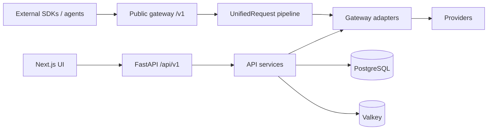

# ToLLma

<!-- TODO(org/repo): replace ORG/REPO below with the canonical GitHub org/repo
     to activate the CI and Pages status badges. -->
[](LICENSE)
[](https://github.com/ORG/REPO/actions)
[](https://github.com/ORG/REPO/actions/workflows/deploy-pages.yml)

> **Toll to your Large Language Models & Agents**

**The Open Source AI Gateway for Models and Agents.**

ToLLma is a self-hosted, unified gateway and workspace for large language models. Register providers once, manage models with repository-backed intelligence, chat with streaming and real cost telemetry, and expose everything to your own tools through OpenAI/Anthropic-compatible `/v1` APIs — with API keys, budgets, rate limits, and analytics built in.

## Why ToLLma

- **One gateway, every provider** — OpenAI, Anthropic, Gemini, Vertex AI, Bedrock, and any OpenAI-compatible endpoint behind a single API.
- **Provider management, not just proxying** — credential validation, model discovery, endpoint-aware routing, and per-model pricing/capability overrides.
- **Model intelligence** — a continuously synced repository (Models.dev is the sole catalog source) that suggests pricing, limits, and capabilities when you register models.
- **Usage tracking that is real** — per-message tokens and costs, conversation analytics, per-API-key analytics, and a platform admin dashboard.
- **Built for agents next** — the unified request pipeline, API-key policies, and request ledger are the foundation for first-class agent support (Planned — see [docs/ROADMAP.md](docs/ROADMAP.md)).

## Core Features

| Area | What you get |
|---|---|
| Chat | Streaming conversations, reasoning display, attachments, regeneration with history, branching, message editing with versions |
| Providers | 6 families, credential validation, discovery, endpoint-aware routing |
| Models | Repository-backed intelligence, pricing/capability/limit metadata |
| Public API | OpenAI Chat + Responses, Anthropic Messages, images, video, models, key identity |
| API keys | Budgets, rate limits, IP allow/deny rules, per-model permissions, analytics |
| Analytics | Conversation, token, cost, performance, and API-key analytics with exports |
| Sharing & export | Public share links, MD/JSON/PDF conversation exports, CSV/XLSX/JSON analytics exports |
| Search | PostgreSQL full-text conversation search |
| Auth | Email + password, Google OAuth, email verification, hardened sessions |
| Admin | Platform-wide dashboard: usage, costs, cache, health, users, API keys |

Full detail: [docs/FEATURES.md](docs/FEATURES.md).

## Screenshots

> UI mockups live on the landing page (`landing/src/components/screenshots.tsx` — labeled CSS/SVG mockups, illustrative until real screenshots ship).

- Chat workspace, Providers workspace, Analytics dashboard, Admin dashboard, Gateway logs: see the landing page Screenshots section.

## Architecture Overview



Layered backend (`api/` → `services/` → `models/`), six provider families behind one adapter contract, Valkey as cache (PostgreSQL stays source of truth). Full detail: [docs/ARCHITECTURE.md](docs/ARCHITECTURE.md).

## Supported Providers

| Provider | Type value | Endpoints |
|---|---|---|
| OpenAI | `OPENAI` | chat, responses, embeddings, images, audio, video |
| Anthropic | `ANTHROPIC_MESSAGES` | messages |
| Google Gemini | `GEMINI` | chat |
| Google Vertex AI | `VERTEX_AI` | chat |
| AWS Bedrock | `BEDROCK_CONVERSE` | converse |
| Custom (OpenAI-compatible) | `CUSTOM` | chat, responses, embeddings, images, audio, video |

Any OpenAI-compatible base URL works as `CUSTOM` (LiteLLM, Ollama, vLLM, OpenWebUI, Azure-compatible). The model — not the provider — decides which endpoint handles a request.

## Installation

Requirements: Docker + Docker Desktop (or compatible engine), ports 3000 / 8000 / 5432 / 6379 free.

```bash
cp .env.example .env
# edit .env — at minimum SECRET_KEY and POSTGRES_PASSWORD
docker compose up -d --build
```

Then open `http://localhost:3000`, sign up, and verify your email.

## Local Development

```bash
# backend (tests, migrations)
cd backend && python -m pytest -q

# frontend (typecheck, lint, unit tests)
cd frontend && npx tsc --noEmit && npm run lint && npx vitest run
```

See [docs/CONTRIBUTING.md](docs/CONTRIBUTING.md) for the full workflow.

## Docker Setup

Services: `postgres` (PostgreSQL 17), `backend` (FastAPI), `valkey` (Valkey 8 cache), `frontend` (Next.js). Key rules:

- Container-to-container traffic uses service names (e.g. `BACKEND_URL=http://backend:8000`).
- Browser-to-backend uses host-mapped ports (e.g. `NEXT_PUBLIC_API_URL=http://localhost:8000`).
- Valkey is cache only — safe to wipe; PostgreSQL is the source of truth.

## Configuration (.env)

| Group | Key variables |
|---|---|
| Project | `PROJECT_NAME`, `PROJECT_DESCRIPTION`, `ENVIRONMENT`, `DEBUG` |
| Frontend | `FRONTEND_PORT`, `NEXT_PUBLIC_API_URL`, `BACKEND_URL`, `NEXT_PUBLIC_APP_NAME` |
| Backend | `BACKEND_PORT`, `API_V1_PREFIX`, `SECRET_KEY`, `BACKEND_CORS_ORIGINS` |
| Postgres | `POSTGRES_DB`, `POSTGRES_USER`, `POSTGRES_PASSWORD`, `POSTGRES_HOST`, `POSTGRES_PORT` |
| Cache | `VALKEY_*`, `CACHE_ENABLED` |
| Auth | JWT/session settings, `GOOGLE_*` OAuth, `FRONTEND_URL`, `SMTP_*` email, password-reset and verification knobs |
| Storage | `LOCAL_STORAGE_PATH`, upload size limits |

The backend refuses to start with missing required secrets and prints exactly which variables are absent. See `.env.example` for the complete, authoritative list.

## API Overview

Public gateway (`/v1`, Bearer API key). Authenticated UI API lives under `/api/v1`.

| Method | Endpoint | Purpose |
|---|---|---|
| POST | `/v1/chat/completions` | OpenAI Chat Completions (JSON + SSE streaming) |
| POST | `/v1/responses` | OpenAI Responses |
| POST | `/v1/messages` | Anthropic Messages |
| GET | `/v1/models` | Models this key may use |
| POST | `/v1/images/generations` | Image generation (capable models) |
| POST | `/v1/images/edits` | Image edits |
| POST | `/v1/videos/generations` | Video generation (capable models) |
| GET | `/v1/me` | Key identity, budgets, limits |

In-app API docs: `/docs` (when the frontend is running). Capability gating returns `403 model_not_allowed` when a model does not support the requested endpoint.

## Security Notes

- **Email verification gate** — new accounts must verify before using features (`403 EMAIL_VERIFICATION_REQUIRED`).
- **Auth rate limiting + login lockout** — fixed-window limits on auth endpoints; lockout on repeated failed logins.
- **Key hashing** — API keys are `tma_sk_live_…`, shown once, stored as SHA-256 only; prefix/mask shown in the UI, never the secret.
- **Hard budgets, no overage** — spend counters are atomic; over-budget keys get 403 before any provider call.
- **Hardened sessions** — refresh rotation with reuse detection, absolute + idle lifetimes, per-user session cap, audit events.
- **Secrets hygiene** — provider credentials are encrypted at rest, masked in responses, never cached, never logged.
- **Account deletion** — 15-day grace (restore anytime) then hard purge with audit row.

Full policy: [docs/SECURITY.md](docs/SECURITY.md).

## Roadmap

- **V1** — Implemented (gateway, chat, providers, keys, analytics, admin, auth hardening).
- **V1.5** — In Progress: none currently open.
- **V2** — Planned: Organizations, Teams, RBAC, billing, agent support.
- **V3** — Vision.

Details: [docs/ROADMAP.md](docs/ROADMAP.md). No dates are promised.

## Contributing

We welcome issues and pull requests. Start here: [docs/CONTRIBUTING.md](docs/CONTRIBUTING.md). Security reports: [docs/SECURITY.md](docs/SECURITY.md). Brand rules for any visual work: [docs/BRAND.md](docs/BRAND.md). FAQ: [docs/FAQ.md](docs/FAQ.md).

## License

Licensed under the Apache License, Version 2.0. See [LICENSE](LICENSE) and [NOTICE](NOTICE) for details