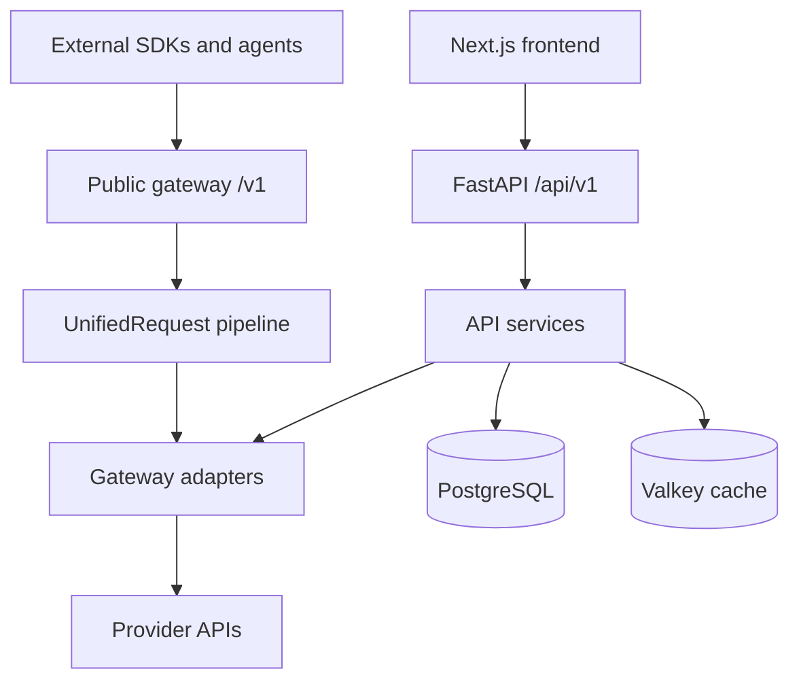
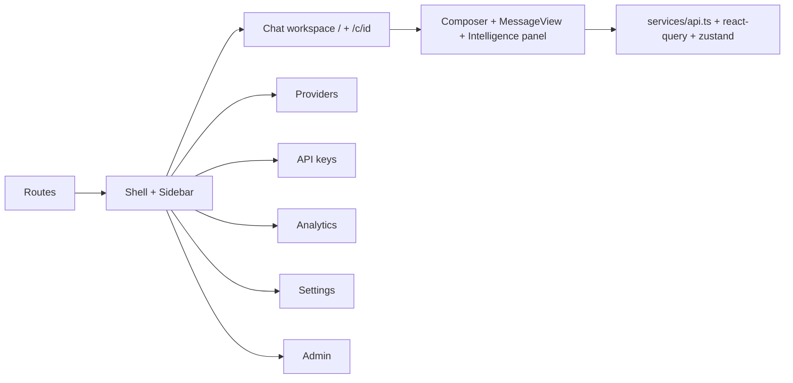
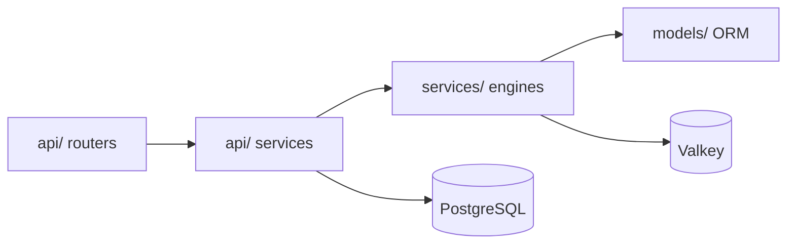
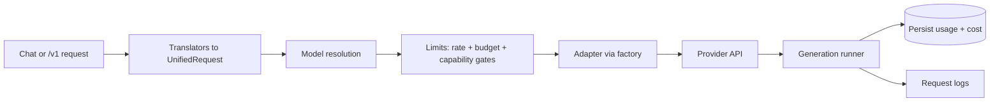
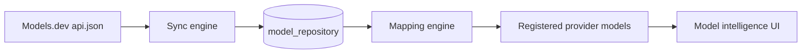
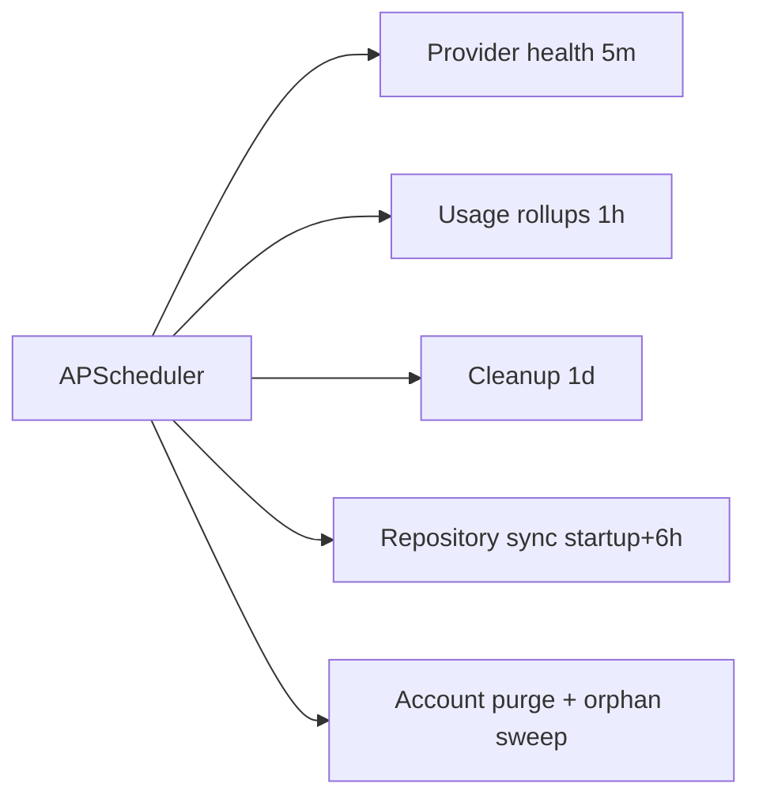
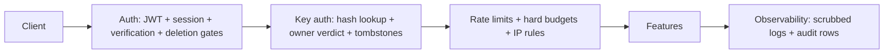

# ToLLma Architecture

> The Open Source AI Gateway for Models and Agents.

This document describes the system as implemented (V1). Layering rule: `api/` → `services/` → `models/`. Services never import from `api/`.

## System Overview



## Frontend Architecture



- Next.js (TypeScript), routes: `/`, `/c/[conversationId]`, `/providers`, `/api-keys`, `/analytics`, `/settings`, `/admin`, `/docs/*`, `/share/[token]`, auth pages.
- State: zustand stores + TanStack Query; silent token refresh with retry on 401.
- Chat UI composes vendored AI-Elements primitives over the custom SSE stream (no `useChat` takeover).

## Backend Architecture



- `api/<feature>/{router,schemas,service}` — thin routers, Pydantic contracts, per-feature services.
- `services/` — reusable engines: `gateway/*` (adapters, factory, dispatch, costing, limits, translators, unified), `model_repository/*` (canonical, mapping, sources, sync, lookup), `analytics/*`, `admin/*`, `cache/*`, `jobs/*`, `observability/*`.
- `models/` — SQLAlchemy ORM aggregate; single import surface via `models/__init__.py`. Alembic must stay `check`-green with one head.

## Gateway Architecture



- `UnifiedRequest` is the single internal shape; OpenAI Chat/Responses, Anthropic Messages, images, and video translators all target it.
- The provider family picks the adapter family; the model's `primary_endpoint` picks the adapter. Endpoint strings are canonical wire paths; the legacy `endpoint_type` enum is mirrored for older readers.
- Media generation rides the same generation lifecycle (cancel, persist, recover, regenerate in place).
- Background jobs (APScheduler): daily provider health validation plus failure-triggered re-validation (throttled), usage rollups, cleanup, account purges.

## Repository Architecture



- Canonical keys (`{provider}/{model}`, lowercase, separator-unified) dedupe repeat syncs; failed runs keep the last-known-good catalog (no deactivation on error).
- Sync is idempotent, per-record fault-isolated, lock-guarded, on a **startup + 6h** schedule; raw payloads preserved per row.
- Repository is global (unowned); registered models link via `repository_model_key` + snapshot and may override pricing/caps.
- Normalization: `provider_catalog` rows (per api.json provider slug, logo URL pattern `models.dev/logos/{slug}.svg`) → `model_repository` association rows (one per provider-scoped model, unique `model_key`) → optional `canonical_model` rows (one per models.json id, linked when the api entry's `canonical_model_id` resolves, else NULL). Pricing/caps/limits live on the association; `reasoning_options` (effort/budget/toggle) and unmodeled cost dims (`extra_cost`) are preserved verbatim and surfaced on model reads for the chat reasoning controls.
- Failed or partial syncs change nothing except bookkeeping (fail-closed); canonical disappearance only NULLs links, never deletes rows.
- **Provider catalog** (`provider_catalog`, sync-owned): every models.dev provider upserted by stable slug with logo/doc/api/npm metadata, gateway-family mapping, and capability flags; vanished providers deactivate (never delete); repository rows link via `catalog_slug`. Catalog metadata never holds credentials and never overrides ToLLma operational state (adapters, credential schemas, enabled flags).

## Jobs Architecture



Dedicated `services/jobs/scheduler.py` engine with lock guards and per-provider exception isolation; skipped under pytest.

## Analytics Architecture

```mermaid
flowchart LR
    MSG[messages + request_logs + api_request_logs] --> ENG[services/analytics engine]
    ENG --> KEY[/api/analytics/* per-key + user]
    ENG --> ADM[/api/admin/* platform]
    ENG --> VK[(Valkey 60s rollups)]
```

Aggregation is 100% backend over the message/request fact tables; the frontend only formats. Reusable engine serves per-key and platform scopes with bounded queries.

## Security Architecture



- JWT access (short) + rotating refresh (`jti`, reuse-revoke, absolute + idle lifetimes, per-user cap).
- API keys: SHA-256 at rest, owner-status verdicts, revocation tombstones, validation 422s.
- Rate limits fail open on cache outage; budgets fail closed. See [SECURITY.md](SECURITY.md).

Related: [FEATURES.md](FEATURES.md) · [ROADMAP.md](ROADMAP.md) · [SECURITY.md](SECURITY.md)
