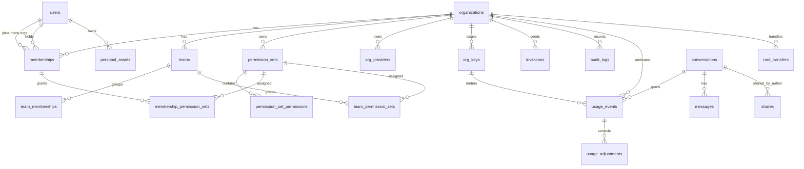

# 06 — Database ERD (FINAL v1 companion, design-level)

Conventions per database.md: UUID PKs, created_at/updated_at, soft-delete (is_deleted/deleted_at/deleted_by) on business tables, explicit FKs + relationships, indexes on org FKs/status/created_at. No secrets at rest (Fernet). One Alembic head.

## New tables (minimal set)

- `organizations` (name, root_user_id FK users, max_spend, visibility_mode, enforcement_on, retention_days, status, settings JSONB).
- `memberships` (org_id, user_id UQ, state, suspended_at, last_active_context).
- `teams` (org_id, name UQ-per-org, description).
- `team_memberships` (team_id, membership FK → memberships, not users directly: leaving org cascades team rows).
- `permission_sets` (org_id NULL for system, name, description, is_system, created_by, updated_by).
- `permission_set_permissions` (set_id, permission_code).
- `membership_permission_sets` / `team_permission_sets` (assignment rows; team rows resolve via member's teams at read or materialized — design-time choice, recommend resolution at read with Valkey caching).
- `invitations` (org_id, email, state, expires_at, invited_by).
- `root_transfers` (org_id, from_user, to_user, state, reauth_proof_ref, expires_at).
- `usage_events` (user_id, conversation_id NULL for API-only calls, org_id NULL, key_id NULL, provider_id, model_id, tokens in/out/cache/reasoning, cost breakdown, occurred_at; NO updated_at semantics — immutable; no soft-delete, purge-by-retention only).
- `usage_adjustments` (adjusts_event_id FK, delta_cost/tokens, reason, actor, audited).
- `audit_logs` (org_id NULL for platform break-glass rows, actor, action, target refs JSONB, created_at only; retention-purged).
- Org columns on V1 tables: providers.org_id NULL (NULL = personal), api_keys.org_id + assignee binding, request_logs.org_id, conversations unchanged (owner = user; NO org_id — ownership never derives; attribution lives on usage_events).

## Index strategy

- All org_id FKs indexed; memberships UQ(org_id, user_id); teams UQ(org_id, name); invitations (org_id, email, state); usage_events (org_id, occurred_at), (conversation_id, occurred_at), (key_id, occurred_at); audit_logs (org_id, created_at, action).
- Partial index for live-only uniqueness where V1 precedent exists (provider names per scope).

## Deletion/purge semantics

- Soft-delete for governance rows (orgs/teams/sets/memberships/keys/invitations).
- Hard purge by retention job only for: usage_events (org delete / global retention), audit_logs (org-configured retention), export artifacts (source retention).
- User conversations/messages: V1 15-day lifecycle, untouched by org operations.
